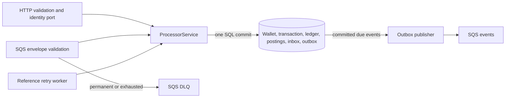
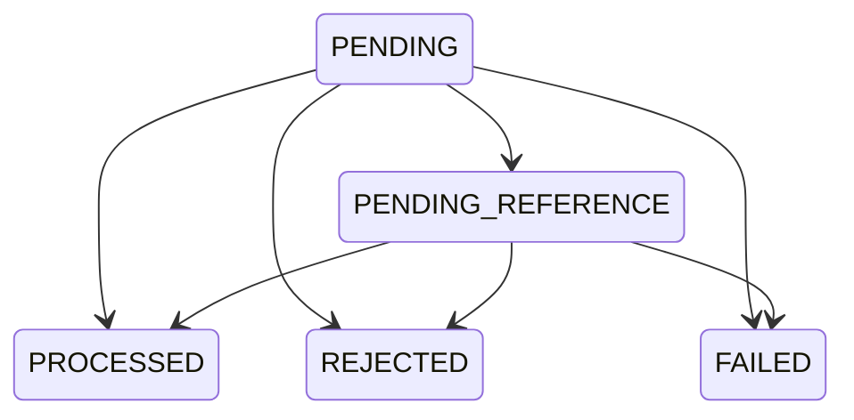

# Architecture — Distributed Wagering Processor

## 1. System boundary and reading guide

This service accepts financial commands through HTTP and an internal SQS channel,
persists an auditable wallet ledger in PostgreSQL, and publishes integration events
through a transactional outbox. PostgreSQL is the authority for balance,
idempotency and concurrency; FIFO delivery is an optimization, not a correctness boundary.

Start with [README setup](README.md#executando-a-implementação) to run locally.
For financial correctness, read sections 2–4; for transport/recovery, sections 5–6;
for deployment and operational limits, sections 7–9.



| Boundary | Responsibility and source |
|---|---|
| Domain | Exact money, wallet movements, immutable entries and transaction state/reference rules; [`src/domain/money.ts:26`](src/domain/money.ts#L26), [`src/domain/wager.ts:61`](src/domain/wager.ts#L61), [`src/domain/events.ts:43`](src/domain/events.ts#L43), [`src/domain/messages.ts:17`](src/domain/messages.ts#L17) |
| Application | Shared parsing/canonical hashing and the financial use case; [`src/application/contracts.ts:83`](src/application/contracts.ts#L83), [`src/application/processor.service.ts:169`](src/application/processor.service.ts#L169) |
| HTTP | Routing, correlation IDs, identity extension and safe error responses; [`src/http/financial.controller.ts:8`](src/http/financial.controller.ts#L8), [`src/http/provider-identity.port.ts:4`](src/http/provider-identity.port.ts#L4), [`src/http/financial-exception.filter.ts:54`](src/http/financial-exception.filter.ts#L54) |
| Workers | Input settlement, committed-outbox publication and reference scheduling; [`src/workers/worker.service.ts:38`](src/workers/worker.service.ts#L38) |
| Infrastructure | MikroORM/pool lifecycle, SQS readiness and financial DML guards; [`src/infrastructure/infrastructure.service.ts:11`](src/infrastructure/infrastructure.service.ts#L11), [`src/infrastructure/database/migrations/Migration202611150002.ts:9`](src/infrastructure/database/migrations/Migration202611150002.ts#L9) |

MikroORM supplies explicit `EntityManager.transactional()` boundaries and parameterized
PostgreSQL access. Critical financial writes use explicit SQL so lock order and
trigger-enforced movements remain visible rather than relying on implicit Unit of Work
flush ordering. Domain classes contain neither Nest decorators nor ORM monetary types.
Nest dependencies use explicit injection tokens because Bun does not emit constructor
metadata; `src/main.ts:1` and `src/app.module.ts` are the composition boundary.

## 2. Exact money and domain transitions

`Money` stores minor units as `bigint`, never JavaScript `number`. Input and output
are `{ "amount": "25.00", "currency": "BRL" }`. Input requires a nonnegative,
fixed-two-decimal string and a supported uppercase ISO-4217 currency. Blank values,
scientific notation, JSON numbers, nonfinite values and extra decimal places are
rejected, not rounded. Leading zeroes are normalized on serialization. Arithmetic
creates new immutable values and rejects mixed currencies; signed arithmetic and
`Money.rehydrate()` support persistence/reconciliation without accepting negative
financial command input (`src/domain/money.ts:37`, `src/domain/money.ts:50`).

PostgreSQL stores amount/balance as `numeric(30,2)`, read as strings. The input parser
counts significant integer digits and removes leading zeroes before `bigint`
conversion, rejecting impossible-to-persist values without expensive arithmetic.
The largest persistable positive amount is `9999999999999999999999999999.99`.
Exact domain arithmetic can exceed that range, so resulting wallet balances are
also bounded before persistence.
PostgreSQL itself can round excessive numeric scale: application validation is
therefore required before SQL, not replaced by the numeric column type.

Raw MikroORM SQL returns PostgreSQL timestamps as strings. Persistence mapping
explicitly reconstructs `Date` values for the domain, response serialization and
reference TTL arithmetic; raw rows are not incorrectly typed as already being dates.

Factories encapsulate construction; `rehydrate` restores persisted state without
replaying business transitions. Wallet and transaction identity fields are readonly,
ledger entries and event data are frozen, and dates are defensively copied.
`Wallet.debit/credit` produces the matching entry while advancing balance/version;
there are no zero-value ledger movements (`src/domain/wager.ts:151`,
`src/domain/wager.ts:177`).



The three settled states are terminal. Re-transitioning them throws
`InvalidTransactionStateError`: this is a programming error, not a business retry.
Repeated reference polling may leave a transaction `PENDING_REFERENCE`; it cannot
return to `PENDING`. The database rejects a commit with an unresolved initial
`PENDING` state or missing result balance. Business rejection is a durable outcome,
not a rollback of the audit record (`src/domain/wager.ts:287`,
`src/infrastructure/database/migrations/Migration202611150002.ts:265`).

| Kind | Amount / balance effect | Reference semantics |
|---|---|---|
| `OPENING` | Positive credit; first entry at version 1 | Internal wallet creation only; rejected by external parsers |
| `BET` | Positive debit; insufficient funds rejects | No reference allowed |
| `WIN` | Positive credit | Optional reference must be a processed `BET` |
| `LOSS` | Exactly `0.00`; no ledger/version increment | Optional reference must be a processed `BET` |
| `REFUND` | Positive credit | Required processed `BET`; exact full amount |
| `ROLLBACK` | Opposite of reference: credit for `BET`, debit for `WIN`/`REFUND` | Required processed `BET`, `WIN` or `REFUND`; exact full amount |

References resolve by `(providerId, referenceExternalTransactionId)`, not by internal
transaction ID. They must match provider, player, wallet, currency and round; `gameId`
is recorded but is not an additional reference-match rule. An unresolved reference
waits; an existing invalid reference is rejected. Partial reversals are unsupported.
Only one processed reversal **per reference and operation kind** is allowed: this is
not a cross-kind exclusion between a `REFUND` and a `ROLLBACK`. A reversal debit
that cannot be funded rejects with `REVERSAL_INSUFFICIENT_FUNDS`, not the ordinary
bet code `INSUFFICIENT_FUNDS` (`src/domain/wager.ts:332`).

## 3. Database as a financial boundary

The original wallet migration retains `(player_id, currency)` uniqueness. The financial
migration adds these durable records (`src/infrastructure/database/migrations/Migration202611150002.ts:22`):

| Table | Identity / invariant |
|---|---|
| `wallets` | Materialized nonnegative balance, immutable owner/currency, version; starts at zero/version 1 |
| `wager_transactions` | Global unique `idempotency_key`; unique `(provider_id, external_transaction_id)`; immutable business payload and terminal outcome; original `balance_after` |
| `wallet_ledger_entries` | Unique `(wallet_id, transaction_id)` and `(wallet_id, wallet_version)`; positive amount, nonnegative endpoints, exact signed arithmetic |
| `inbox_messages` | Primary key `(consumer_name, message_id)`; immutable identity/hash and processed content |
| `outbox_messages` | Stable event ID and immutable JSONB envelope; mutable retry/publication state only until publication |
| `accounting_postings` | Exactly one immutable debit and credit per wallet journal; exact account identity, amount and currency; totals balance at commit |

The ledger is not merely written alongside a wallet update. Its **BEFORE INSERT
trigger** locks the wallet, checks transaction status/scope/amount/currency/direction,
checks `balance_before` against the locked wallet, and requires the next wallet version.
Only that trigger updates materialized balance/version. `OPENING` is the sole version-1
movement and must be the first entry. Direct wallet updates are rejected
(`src/infrastructure/database/migrations/Migration202611150002.ts:216`).

Deferred, initially-deferred constraint triggers inspect final state at commit:

- Every processed balance-affecting transaction has exactly one matching entry and
  its stored response balance equals that entry's `balance_after`.
- `LOSS`, `REJECTED`, `FAILED` and `PENDING_REFERENCE` have no ledger entry.
- A wallet equals its latest ledger balance/version/timestamp, or remains zero/version 1
  with no entries.
- Reference scope, processed-reference state, allowed reference kind and full reversal
  amount are also enforced by transaction triggers. A partial unique index enforces
  one processed `REFUND`/`ROLLBACK` of each kind per reference.

Ledger UPDATE/DELETE/TRUNCATE, audit table DELETE/TRUNCATE, transaction payload
mutation and terminal updates are rejected at the schema boundary, not just by domain
methods. SQL indexes support due-reference/outbox scans and wallet ledger keysets.
These are ordinary-role DML guarantees: a database owner/superuser can alter or disable
triggers. Production runtime credentials must not own the schema or hold DDL/trigger
privileges; the local Compose database user is not a hardened role separation.

The migration refuses preexisting wallets with nonzero balance or version other than 1:
it does not invent historical opening entries. A positive new opening balance instead
creates an internal `OPENING` transaction and credit in the wallet-creation SQL unit;
a zero opening has no financial entry.

### 3.1 Shared SQL unit and lock order

`ProcessorService.process()` re-parses the command even outside HTTP. Queue input
first inserts/locks its inbox identity, compares hashes and short-circuits completed
redelivery. A new command then locks its wallet **before inserting child transaction
rows**, avoiding foreign-key `KEY SHARE` → `UPDATE` lock-upgrade races. It inserts the
transaction with `ON CONFLICT DO NOTHING` or locks existing identity rows in ID order.
The stable financial write order is optional inbox → wallet → transaction; trigger
wallet locks are reentrant (`src/application/processor.service.ts:169`).

Reference retry also locks an eligible wallet with `FOR UPDATE SKIP LOCKED` before
claiming its due transaction row. Same-wallet operations serialize; unrelated wallets
do not share that row lock. PostgreSQL deadlock/serialization/lock-unavailable states
`40P01`, `40001`, `55P03` retry the **whole** SQL unit at most twice after the first
attempt, with 10 ms then 20 ms delays; exhaustion returns `503`. These retries are
defensive, not a replacement for lock ordering (`src/application/processor.service.ts:50`).

Transaction outcome/result balance, matching ledger insertion, outbox events and
inbox completion commit together. No SQS call runs inside this financial transaction.
The domain computes the intended movement; the application never directly persists
the new wallet balance. The ledger trigger owns that write. Credits exceeding
`numeric(30,2)` reject durably with `BALANCE_LIMIT_EXCEEDED`; unsuccessful balance
checks produce no ledger/version change.

### 3.2 Canonical SHA-256 and original-result replay

The wagering hash is SHA-256, encoded as lowercase hexadecimal, over UTF-8
`JSON.stringify()` of the **parsed business input**. Object keys are recursively
sorted lexically; undefined object members are omitted; arrays retain order.
Parser normalization happens first (lowercase UUIDs and canonical money strings).
Fields are `providerId`, `externalTransactionId`, `playerId`, `walletId`, `roundId`,
`gameId`, `kind`, `money` and optional `referenceExternalTransactionId`. HTTP keys
and correlation headers, SQS identity and timestamps are excluded from this
business hash (`src/application/contracts.ts:107`,
`src/application/processor.service.ts:172`).

Both global key and provider/external identity must identify the same row:

- Same key and normalized business hash: persistent replay with
  `idempotentReplay: true`, without new ledger or outbox entries.
- Same key with changed payload: `409 IDEMPOTENCY_CONFLICT`, including a changed
  wallet ID that does not exist. Established identities are checked before wallet
  lookup; unique inserts/locked reads remain the authority for concurrent races.
- Same provider/external identity with a **different key**, even with identical body:
  `409 IDEMPOTENCY_CONFLICT`; no alias key is silently created.
- Key and provider/external identity pointing at different rows:
  `409 IDEMPOTENCY_CONFLICT`.

Replay uses persisted transaction `balance_after`, never the wallet's current amount.
A later win/bet cannot change the response balance of an earlier settled request.
Terminal status/failure/result are immutable. Pending transactions are not terminal:
queries/replays return the latest durable state and stored balance as scheduled
resolution proceeds (`src/application/processor.service.ts:99`).

Inbox deduplication separately stores a canonical hash of `{ input, idempotencyKey }`
for `(consumer_name, message_id)`, deliberately including the key. Reusing that
envelope identity with changed business data/key is `409 INBOX_PAYLOAD_CONFLICT`;
changing only transport timestamps is not a new financial command. Inbox completion
acknowledges durable acceptance, including `PENDING_REFERENCE`, not settlement.

### 3.3 Bounded out-of-order references

Missing references and references still `PENDING`/`PENDING_REFERENCE` persist
`PENDING_REFERENCE` with no balance change and one initial pending event. Each
scheduler iteration handles at most 20 due transactions, one SQL unit per row,
using wallet then transaction `FOR UPDATE SKIP LOCKED` claims. Instances skip busy
wallets instead of sharing a scheduler-global lock
(`src/application/processor.service.ts:237`, `src/application/processor.service.ts:293`).

Initial acceptance schedules the first retry after the base delay without counting
an attempt. A retry that remains pending increments `reference_attempts`; its next delay is
`min(300000, REFERENCE_RETRY_BASE_MS × 2^attempts)` milliseconds. At ten unsuccessful
retries or 24-hour age by default, an unresolved reference becomes terminal
`REJECTED/REFERENCE_NOT_FOUND`, with a rejection event. These bounds prevent infinite
orphan polling; defaults can reach the attempt limit well before 24 hours.
TTL is checked on due retry, not by an independent expiry timer. A valid reference
already available when retried is applied rather than retroactively expired.

Existing rejected/failed references reject with `REFERENCE_NOT_PROCESSED`.
Immutable scope/kind/amount rules are checked even when an existing reference is
still pending: an impossible reference is rejected immediately rather than timing
out with a misleading missing-reference code. Successful retry emits ordinary
processed and, when applicable, balance-changed events atomically with the movement.

### 3.4 Double-entry accounting

Migration `202611150003` makes the existing immutable wallet ledger entry the
accounting journal header: its `id` identifies the journal. An AFTER INSERT trigger
creates both postings in the same financial SQL unit; there is no second wallet
movement, extra financial transaction or extra integration event.

| Account type | Account reference | Meaning |
|---|---|---|
| `WALLET_LIABILITY` | Wallet UUID | Credit increases the amount owed to the player; debit reduces it |
| `PROVIDER_CLEARING` | Provider ID | Opposite side of game movements and reversals |
| `OPENING_CLEARING` | `opening` | Opposite side of initial wallet funding |

Account identity is `(account_type, account_reference, currency)`. Clearing balances
may be debit or credit net; they are not constrained like a player wallet. These
accounts represent internal opening/provider clearing, not bank cash or completed
external settlement. There is no persisted shared clearing-balance row or global
provider lock: unrelated wallets remain independent.

Posting insertion validates the journal, transaction, account/reference, direction,
amount and currency. The primary key allows one posting per journal/direction;
deferred constraint triggers require exactly two, with each side equal to the journal
amount in its currency. UPDATE, DELETE and TRUNCATE are forbidden. A missing or
invalid side aborts the entire wallet/transaction/ledger/postings/inbox/outbox commit.
`LOSS`, pending and rejected operations have no journal and therefore no postings.
Reversals naturally invert the referenced movement through the existing ledger rules.

The migration takes a ledger-writer table lock through its set-wise historical
backfill and trigger cutover. Original ledger rows, timestamps, wallet balances,
versions and events are unchanged; downtime/timeout planning is required for a
large historical dataset. Downgrade removes only the new accounting objects;
reapplying regenerates historical postings from the preserved journals.

`accounting_trial_balance` exposes debit totals, credit totals and signed
`credits - debits` by account and currency. Totals use unbounded PostgreSQL `numeric`,
not a per-entry `numeric(30,2)` cast: turnover may exceed the maximum wallet balance.
Ledger HTTP items retain their existing fields and cursor, adding a `postings` array
with `accountType`, `accountReference`, `direction` and decimal-string `money`.

## 4. HTTP contract and failure taxonomy

Controllers use the same processor as the queue. Unknown payload fields are rejected,
UUIDs normalize to lowercase, and business text/key identifiers contain 1–128 printable
ASCII characters without spaces. `Idempotency-Key` is required on wagering POSTs;
`X-Correlation-Id` is optional, validated, generated if absent and returned in the
response (`src/application/contracts.ts:39`, `src/http/financial.controller.ts:56`).

| Route | Success / meaning |
|---|---|
| `POST /wallets` | `201`; wallet with exact balance and version |
| `GET /wallets/:walletId` | `200`; current materialized balance |
| `GET /wallets/:walletId/ledger?cursor=…&limit=50` | `200`; stable opaque keyset pagination |
| `POST /wagering/transactions` | `200 PROCESSED`, `202 PENDING_REFERENCE`, `422 REJECTED`, `503 FAILED` |
| `GET /wagering/transactions/:transactionId` | `200`; durable transaction |
| `GET /providers/:providerId/wagering/transactions/:externalTransactionId` | `200`; provider-scoped lookup |
| `POST /wallets/:walletId/reconciliation` | `200`; stored/calculated balance, signed difference, entry count and consistency |
| `GET /metrics` | Prometheus text exposition |
| `GET /health/live`, `GET /health/ready` | Public process/dependency probes |

A settled/rejected/pending command result contains `transactionId`, `status`, exact
`balance`, `idempotentReplay`, and `failureCode` when applicable. Transport errors use
`{ statusCode, code, message, correlationId }`. The exception filter never exposes raw
SQL, driver messages, stack traces or request bodies; unknown bugs are `500 INTERNAL_ERROR`,
recognizable dependency/serialization/lock failures are `503 INFRASTRUCTURE_UNAVAILABLE`
(`src/http/financial-exception.filter.ts:54`).

| Category | HTTP / representative stable codes | Caller action |
|---|---|---|
| Invalid contract | `400`: `INVALID_PAYLOAD`, `INVALID_MONEY`, `INVALID_AMOUNT`, `AMOUNT_OUT_OF_RANGE`, `INVALID_KIND`, `REFERENCE_REQUIRED`, `REFERENCE_NOT_ALLOWED`, `IDEMPOTENCY_KEY_REQUIRED`, `INVALID_CORRELATION_ID`, `INVALID_PAGINATION`, `INVALID_LIMIT`, `INVALID_CURSOR` | Correct input before retry |
| Missing resource | `404`: `WALLET_NOT_FOUND`, `TRANSACTION_NOT_FOUND` | Correct wallet/transaction identity |
| Identity conflict | `409`: `IDEMPOTENCY_CONFLICT`, `INBOX_PAYLOAD_CONFLICT`, `WALLET_ALREADY_EXISTS`, `CONFLICT` | Do not overwrite an existing operation with different business data |
| Financial rejection | `422`, persisted `failureCode` | Inspect terminal outcome; replay does not reconsider it |
| Waiting for reference | `202 PENDING_REFERENCE` | Query outcome; scheduled worker owns resolution |
| Transient dependency | `503 INFRASTRUCTURE_UNAVAILABLE` | Retry the same identity/key, with backoff |
| Unexpected programming failure | `500 INTERNAL_ERROR` | Investigate using correlation ID |

Financial failure codes include `INSUFFICIENT_FUNDS`, `REVERSAL_INSUFFICIENT_FUNDS`,
`WALLET_PLAYER_MISMATCH`, `CURRENCY_MISMATCH`, `BALANCE_LIMIT_EXCEEDED`,
`REFERENCE_MISMATCH`, `REFERENCE_KIND_INVALID`, `REFERENCE_NOT_PROCESSED`,
`REFERENCE_AMOUNT_MISMATCH`, `ALREADY_REVERSED`, `REFERENCE_NOT_FOUND` and
`INFRASTRUCTURE_PERMANENT`. `FAILED` is a terminal domain/schema state with `503`
HTTP and DLQ mappings; the current command processor settles accepted operations as
`PROCESSED`, `REJECTED` or `PENDING_REFERENCE`. Infrastructure exceptions roll back;
exhausted input goes to DLQ without inventing a committed `FAILED` financial row.
No failed or rejected outcome moves money.

Ledger pages order by immutable `wallet_version`, default to 50 entries and allow
1–200. The base64url cursor binds format version, wallet ID and last wallet version;
clients treat it as opaque, not as a security credential.
Reconciliation reads wallet, journal and accounting data in one `REPEATABLE READ`
snapshot. It verifies the balance chain starts at zero, each entry begins at the
previous entry's ending balance and its arithmetic is exact. Versions must be
contiguous: OPENING starts at 1, an unfunded wallet's first movement starts at 2,
and the latest journal version must match the wallet (no journals means version 1).
Journal reconstruction uses unbounded numeric sums, so oversized corrupted history
is reported rather than failing a `numeric(30,2)` cast.
`difference` remains stored minus journal-calculated balance. The added
`accounting` result checks every journal pair, account mapping, amount/currency,
liability balance and journal/posting counts; it exposes exact debit/credit totals.
Overall `consistent` requires both journal and accounting consistency. Broken
balance/version history or accounting-only drift can therefore return
`difference: 0.00` with `consistent: false`. Divergences
are returned, logged and counted, never silently corrected.

## 5. SQS, inbox and outbox

Three separate FIFO queues are used; events must never feed the command consumer:

| Queue | Configuration | Purpose |
|---|---|---|
| `wager-transactions.fifo` | `SQS_QUEUE_URL` | Internal `WagerTransactionRequested` input |
| `wager-transactions-dlq.fifo` | `SQS_DLQ_URL` | Invalid/permanent/exhausted input, with failure attributes |
| `wager-events.fifo` | `SQS_EVENTS_QUEUE_URL` | Published integration-event envelopes |

Input uses the envelope from the preserved README: `messageId`,
`type: "WagerTransactionRequested"`, canonical ISO `occurredAt`, and `data` containing
the business fields plus `idempotencyKey`. It is not a bare HTTP body. Producers set
FIFO `MessageGroupId` (normally wallet ID) and explicit `MessageDeduplicationId`;
content-based deduplication is disabled. Input is trusted transport, not trusted
business data: it passes the same strict command and domain validation as HTTP.

The consumer uses five-second long polling and up to ten concurrent messages per
batch. PostgreSQL serializes same-wallet operations, including when one SQS batch
contains several operations in the same FIFO group. The inbox consumer name is
`wager-transactions`. A resolved processor call means its SQL commit has completed;
only then is the input deleted. Business `REJECTED` and durable `PENDING_REFERENCE`
are acknowledged: they do not consume broker retries while waiting for a reference.

Malformed messages, permanent 4xx application errors and `FAILED` outcomes go to DLQ;
transient errors retry through visibility changes. On receive attempt `n`, delay is
`min(300, 2^(min(n−1,9)))` seconds; attempts default to five. The original message body
is preserved in DLQ, with safe `failureCode`, `receiveCount` and `correlationId`
attributes. The worker deletes input **only after successful DLQ send**. Failure of
DLQ send/delete or ACK leaves the broker able to redeliver. A FIFO redrive policy of
five receives is an additional local broker fallback, not the financial guarantee
(`src/workers/worker.service.ts:126`).

The four concrete integration events have version 1:

- `WagerTransactionProcessed`: any processed transaction, including `LOSS`.
- `WagerTransactionRejected`: terminal business rejection.
- `WalletBalanceChanged`: an actual balance change, carrying entry and wallet version.
- `WagerTransactionPendingReference`: durable missing-reference acceptance.

Each envelope has `eventId`, `eventType`, `aggregateId`, `correlationId`, optional
`causationId`, ISO `occurredAt`, `version` and JSON-safe `data` containing `MoneyProps`,
never a `bigint` or domain instance. Balance events aggregate by wallet; transaction
events aggregate by transaction (`src/domain/events.ts:43`).

Publishers claim one due outbox row inside a separate SQL transaction using
`FOR UPDATE SKIP LOCKED`, send to the **events** queue, then set `published_at`.
A publisher holds only the outbox claim during SQS I/O, not a financial wallet lock.
FIFO group is `aggregateId`, deduplication ID is the stable event ID. On failure,
attempts and `next_attempt_at` persist; backoff starts at one second, doubles and caps
at five minutes. Outbox retries have no expiry/deletion limit: confirmed events must
not be discarded during a long outage (`src/domain/messages.ts:116`).

Delivery is **at least once**, not exactly once: a crash after send but before marking
publication can repeat an event, including beyond FIFO's deduplication window.
Downstream consumers must durably deduplicate `eventId`. Concurrent publishers skip
locked rows; consequently there is no guarantee of strict event-time ordering across
all events or even all events of one wallet. Consumers should use event IDs and wallet
versions rather than assume delivery order.

| Crash / fault window | Recovery |
|---|---|
| Before financial commit | SQL rollback; same-key redelivery can safely process |
| Commit before input ACK | Durable idempotency/inbox replay; no repeated movement |
| Commit before outbox send | Another publisher finds the pending row |
| Send before publication mark commit | Same event ID may publish again; consumer deduplicates |
| DLQ send before input delete | DLQ/input redelivery remains possible; no financial duplication |

## 6. Worker configuration and shutdown

| Variable | Default | Meaning |
|---|---|---|
| `DATABASE_URL` | Required | PostgreSQL connection URL |
| `AWS_REGION` | Required | SQS region; credentials use AWS SDK provider chain |
| `SQS_ENDPOINT` | Unset | LocalStack override; omit for AWS |
| `SQS_QUEUE_URL` | Required | Input queue URL |
| `SQS_DLQ_URL` | Input URL with last path segment replaced by `wager-transactions-dlq.fifo` | Explicit override recommended outside local setup |
| `SQS_EVENTS_QUEUE_URL` | Input URL with last segment replaced by `wager-events.fifo` | Must differ from input and DLQ |
| `PORT` | `3000` | HTTP listener |
| `HOST` | `0.0.0.0` | Listener IP or `localhost`; isolated benchmark processes explicitly bind `127.0.0.1` |
| `WORKERS_ENABLED` | `true` | Start consumer, publisher and reference loops |
| `WORKER_INTERVAL_MS` | `250` | Idle/error loop interval |
| `SQS_VISIBILITY_TIMEOUT` | `30` seconds | In-flight lease refreshed by heartbeat |
| `SQS_MAX_ATTEMPTS` | `5` | Application receive limit before DLQ |
| `REFERENCE_MAX_ATTEMPTS` | `10` | Bounded reference polling attempts |
| `REFERENCE_RETRY_BASE_MS` | `1000` | Reference backoff base |
| `REFERENCE_TTL_MS` | `86400000` (24 hours) | Maximum reference age |

Configuration is validated at startup; invalid integers, protocols, booleans and
identical queue URLs fail fast (`src/config.ts:18`). Changing application receive
limits does not automatically change the broker redrive policy; deploy those together.

Loops do not overlap within an instance, and database claims coordinate instances.
Workers start without blocking Nest bootstrap. In-flight input visibility is refreshed
roughly every visibility-timeout/3, clamped between 250 ms and 10 seconds. SQS SDK
calls use bounded network timeouts, with automatic SDK retries disabled so worker
backoff is explicit.

On SIGTERM/SIGINT, Nest shutdown hooks stop new work, abort long polls/sleeps and await
in-flight processing/publication/reference tasks. A financial SQL commit is not aborted
mid-flight by the shutdown signal. Received-but-not-started or failed work during shutdown
has visibility returned to zero; successfully committed work can finish ACK. Heartbeat
timers stop after settlement. The SQS client and PostgreSQL pool close only after the
worker `beforeApplicationShutdown` drain. Forced termination is still a crash-recovery
case, not an exactly-once guarantee (`src/workers/worker.service.ts:71`,
`src/infrastructure/infrastructure.service.ts:52`).

## 7. Security decision: external IdP deferred explicitly

Authentication is intentionally deferred as allowed by challenge section 2. The bound
`LocalProviderIdentity` validates provider text only and **does not authenticate or
authorize**. `ProviderIdentityPort.authorize(providerId, context)` is the explicit HTTP
extension, invoked for wagering submission and provider-scoped lookup
(`src/http/provider-identity.port.ts:4`). It is not a production-ready permissive guard.

For an external IdP such as Keycloak/Zitadel, replace that binding with OIDC verification
of issuer, audience, expiry and signature/JWKS, then bind the authenticated principal's
allowed provider claims to the supplied `providerId`. Wallet administration, wallet
reads and transaction-by-ID access need their own authorization policy as well: they
are not protected by the provider port. No local password table or handmade token
issuer is introduced. Health remains public; internal SQS relies on queue/IAM isolation
and still enforces provider/domain scope. Restrict local financial/metrics access and
require TLS, least-privilege network/IAM/database roles before a production deployment.

## 8. Observability and diagnostics

Nest emits JSON logs. Financial paths log allowlisted identifiers (`correlationId`,
`messageId`, `transactionId`, `walletId`, `providerId`), event/status/code and retry
metadata when available; they do not log full financial payloads, amounts, credentials,
SQL or arbitrary exception objects. Correlation IDs connect HTTP failures and committed
transaction processing; SQS-generated correlation IDs connect message handling/events.
Malformed-envelope logs retain the separate broker `sqsMessageId`. Outbox logs
project safe identifiers and causation from the persisted envelope, without logging
the payload. Unavailable identifiers are null; worker failures distinguish expected
infrastructure errors from unexpected error types without exposing SQL or stacks.

`GET /metrics` exposes process-local Prometheus counters/gauges and latency sum/count:

- `wagering_transactions_total{status}` and `wagering_duplicates_total`;
- `wagering_retries_total{worker}`, `wagering_dlq_total`, `wagering_lock_conflicts_total`;
- `wagering_outbox_lag_seconds` (oldest unpublished event age);
- `wagering_processing_seconds_sum` / `_count`;
- `wagering_reconciliation_mismatches_total`.

Counters reset on process restart and should be scraped per instance; they are not
financial audit records. Latency is an aggregate sum/count, not a histogram or a claim
of p95/p99 latency. Outbox lag is sampled by the publisher; lack of scrapes/worker
activity must not be interpreted as absence of backlog (`src/metrics.ts:4`).

Liveness tests the running HTTP process. Readiness performs `SELECT 1` plus
`GetQueueAttributes` for input, DLQ and events queues, with three-second SQS health
request timeouts. It returns `503` if either dependency family fails; it does not
prove worker progress, migration compatibility, downstream consumption or end-to-end
publish permissions (`src/infrastructure/infrastructure.service.ts:37`).

Operational checks: use the returned correlation ID for `503`/`500`; inspect DLQ failure
attributes rather than resending with a new key; investigate rising outbox lag and SQS
permissions/connectivity; query reference-pending status before its retry deadline.
A reconciliation mismatch is an incident to investigate, not a reason to edit ledger
rows or mutate a terminal transaction.

## 9. Deployment, limits and evidence

Run versioned migrations as a **single deployment job before application instances**;
do not use ORM schema synchronization or race migration execution across replicas.
`bun run db:migrate` applies pending versions; `bun run db:rollback` reverts the latest
migration. The financial down migration removes new audit tables/functions/triggers and
restores the original wallet guards, but destroys their audit history; rolling back the
initial migration drops wallets. Use disposable databases or an approved backup/restore
plan. A rollback is not a financial reversal (`src/infrastructure/database/migrate.ts:11`,
`src/infrastructure/database/migrations/Migration202611150002.ts:380`).

The local image migrates, then uses `exec bun src/main.ts`, so Bun becomes PID 1
and receives container termination signals directly. Compose grants 30 seconds
for graceful shutdown; completed worker draining emits `workers_drained`.
For scaled deployment, override startup to `bun src/main.ts` and run migrations
once as the preceding deployment job. Bootstrap itself never synchronizes or
migrates the database.

Local Compose is a single-host development deployment: PostgreSQL named volume,
LocalStack SQS, fixed localhost ports, development credentials and no external IdP,
TLS, managed queue durability or production role hardening. LocalStack state is not
backed by the PostgreSQL volume. The default app port mapping is for one app container;
multiple processes/replicas require separate listener ports/network routing. No global
in-memory lock or in-memory idempotency state is part of financial correctness.

Hot-wallet commands intentionally serialize on a PostgreSQL row; distinct wallets do
not share that row lock. Publisher claims hold a database transaction during a bounded
SQS request. These are explicit simplicity/consistency trade-offs, not measured capacity
claims. Wallet journals now carry balanced, immutable double-entry postings.
The local benchmark below is an observed experiment, not a production-capacity,
availability or saturation guarantee.

Runnable verification commands are `bun run typecheck`, `bun run test:unit` and,
with real PostgreSQL/LocalStack available, `bun run test:integration`. The integration
suite creates its own uniquely named database/FIFO queues and application child
processes. It deliberately requires the local PostgreSQL superuser: a temporary
`session_replication_role='replica'` override simulates drift only in its isolated
database to exercise reconciliation without repair. It also needs database create/drop,
`pg_terminate_backend` and queue lifecycle permissions. Never run it with production
credentials; these test privileges are not the runtime security model
(`test/financial.integration.test.ts:84`). See README for Compose/migration commands.

Observed verification:

- `bun run typecheck`: passed.
- `bun run test:unit`: 43 tests passed.
- `bun run test:integration`: passed against real PostgreSQL and LocalStack;
  20 wallets reconciled and all 251 committed event envelopes were received.
- The integration run exercised 50 simultaneous duplicates over three Bun
  processes, competing 80.00 bets, distinct wallets, all financial operation kinds,
  full/partial and unfunded reversals, original-result replay, durable inbox
  conflicts/redelivery, commit-before-ACK process death, concurrent publishers,
  reference expiry, queue retry/DLQ, outbox recovery and restart consistency.
- Migrations were reversed/reapplied in the isolated database. Forced SQL failures
  proved wallet/ledger/inbox/outbox rollback together; schema mutation attempts
  were rejected. Deliberate isolated drift was reported without silent repair.
- The rebuilt Docker application passed live HTTP wallet creation, simultaneous
  competing bets, original-result replay, ledger reconciliation and metrics checks.
  Container restart emitted `workers_drained` from PID 1 and restored readiness 200.
- Double-entry checks covered populated migration downgrade/re-backfill without
  financial changes, immutable posting guards, missing-side commit rollback,
  per-currency pairs, turnover beyond the per-entry storage range and
  accounting-only drift detection.
- Twenty simultaneous distinct REFUNDs and twenty debit ROLLBACKs, each racing
  across three processes, produced exactly one financial reversal per reference/kind;
  losers remained durable `ALREADY_REVERSED` rejections without postings.
- Reconciliation regressions reproduced false-clean balance/version history and
  an oversized reconstruction returning HTTP 500 before the fix. The corrected
  audit reports each inconsistency, keeps exact signed totals and leaves stored
  rows unchanged. Empty, initially unfunded and funded histories also reconcile.

## 10. Reproducible local load benchmark

Run with PostgreSQL and LocalStack already available:

```sh
LOAD_REPORT=benchmarks/baseline.json bun run test:load

# Repeat the complete workload sequentially at concurrency 1, 24 and 48:
bun run test:load:matrix
```

The native Bun runner creates a UUID-named temporary database, three private FIFO
queues and local application processes, then removes only those resources. It
rejects remote database/SQS hosts, PostgreSQL query overrides and arbitrary target
URLs. Application children bind `127.0.0.1`; the user's existing database and queues
are not reset. No new load-testing dependency is required.

Default controls are three application instances, concurrency 24, 32 funded
wallets, 100 warmup requests and 1,000 measured requests **per phase**. Each request
is a `0.01 BRL` BET against an initial `1000000.00 BRL` wallet. The phases are
deterministic round-robin distinct-wallet writes, one hot wallet, and one identical
idempotency operation repeatedly submitted across instances.

This is fixed-count **closed-loop** load: a client worker sends its next request
after consuming the preceding response body. Latency uses monotonic
`performance.now()` from dispatch through body consumption, including failed
requests. Percentiles use nearest rank `ceil(p * n) - 1` on sorted samples.
Migration, funding, warmup, metric scrapes, outbox drain and reconciliation are
outside HTTP-throughput timing. Publishers run concurrently during measurement.
Counter deltas extend through the corresponding outbox drain so publication retries
are not lost between phase boundaries.

The SQL sampler records pending outbox count and oldest pending age every nominal
250 ms without overlapping queries. Samples bracket requests; query time increases
the actual interval. Reported peaks are **observed samples**, not continuous maxima;
a zero observation can miss a short-lived backlog. Drain timing/backlog are recorded
separately. HTTP acknowledgment throughput does not measure downstream event-consumer
throughput, and duplicate-request throughput is not new financial-commit throughput.

### Recorded concurrency matrix

The matrix completed 9,000 measured requests. Full reports, raw latency samples,
SQL observations, package/image versions, PostgreSQL settings and cleanup status:
[`concurrency-1.json`](benchmarks/concurrency-1.json),
[`baseline.json`](benchmarks/baseline.json) (concurrency 24), and
[`concurrency-48.json`](benchmarks/concurrency-48.json).
Each configuration uses a fresh owned database, queues and three app processes;
profiles run sequentially, not concurrently against the same infrastructure.
These runs used Linux x64, kernel `7.0.0-43-generic`, Intel Core i7-13620H
with 16 reported logical CPUs and 16,452,562,944 bytes reported RAM. Runtime was
Bun 1.3.14 (Node compatibility v24.3.0), NestJS 11.2.10, MikroORM 6.6.17,
PostgreSQL 17.11 (`postgres:17-alpine`) and LocalStack 4.14.0.
PostgreSQL had `fsync`/`synchronous_commit` enabled, 100 maximum connections and
128 MiB shared buffers. Each application pool allowed ten connections.
The benchmark explicitly enabled workers with a 20 ms idle/error interval; the
normal application default is 250 ms. Full PostgreSQL/pool settings and immutable
image IDs are recorded in the JSON.

| Concurrency | Phase | HTTP req/s | Unique commits/s | p50 ms | p95 ms | p99 ms | Error % | Lock conflicts | Observed peak outbox lag s | Drain s |
|---:|---|---:|---:|---:|---:|---:|---:|---:|---:|---:|
| 1 | Distinct wallets | 25.72 | 25.72 | 36.90 | 55.20 | 81.50 | 0 | 0 | 0.155 | 0.057 |
| 1 | One hot wallet | 29.67 | 29.67 | 33.08 | 45.91 | 51.78 | 0 | 0 | 0.056 | 0.054 |
| 1 | Duplicate replay | 72.91 | 0.073 | 13.45 | 19.62 | 25.03 | 0 | 0 | 0.000 | 0.001 |
| 24 | Distinct wallets | 159.43 | 159.43 | 146.32 | 194.62 | 214.53 | 0 | 0 | 5.654 | 19.974 |
| 24 | One hot wallet | 35.44 | 35.44 | 877.26 | 1096.28 | 1218.63 | 0 | 0 | 0.081 | 0.064 |
| 24 | Duplicate replay | 111.60 | 0.112 | 215.04 | 264.02 | 286.09 | 0 | 0 | 0.000 | 0.002 |
| 48 | Distinct wallets | 191.41 | 191.41 | 246.47 | 324.04 | 354.67 | 0 | 0 | 5.037 | 20.940 |
| 48 | One hot wallet | 47.94 | 47.94 | 951.40 | 1759.09 | 1987.06 | 0 | 0 | 12.444 | 12.073 |
| 48 | Duplicate replay | 117.58 | 0.118 | 407.38 | 508.05 | 574.60 | 0 | 0 | 0.179 | 0.002 |

Each replay phase committed exactly one debit and returned 999 persistent replays.
No retries were recorded. Lock-conflict counters count SQL conflict errors, not
ordinary successful row-lock waiting; they do not establish absence of contention.
[INFERENCE] Lower hot-wallet throughput under concurrent load is consistent with
intentional per-wallet serialization, but these runs do not isolate CPU, I/O,
scheduling or driver costs. Concurrent distinct-wallet phases and the highest-
concurrency hot-wallet phase accumulated publication backlogs and required drain
time. HTTP acknowledgment throughput must not be presented as event throughput.

Each run reconstructed all 32 workload balances and versions, checked 2,133
journals with 4,266 exact paired postings, and found no invalid journals, postings,
forbidden movements or pending outbox rows. All 4,266 outbox messages per run were
marked published after SQS acknowledgment. Per-wallet HTTP reconciliation passed.
Every run cleaned its resources without errors. This tests HTTP ingestion and
publication, not SQS-input throughput or downstream consumption under load.

The load generator, three app processes, PostgreSQL and LocalStack share a host;
other local workloads were not isolated. Logging, metrics and SQL sampling add
observer overhead. There is one short run per concurrency in fixed configuration
and phase order, not a repeated or randomized comparison. Closed-loop timings
have coordinated omission. These observations are not an open-loop saturation
test, SLO or production capacity estimate; there is no RPS acceptance threshold.

### Controls and artifacts

Use `LOAD_INSTANCES` (1–8), `LOAD_CONCURRENCY` (1–256), `LOAD_REQUESTS` (1–100000
per phase), `LOAD_WALLETS` (2–1000), and `LOAD_WARMUP` (0–10000) to reproduce other
workloads. Network, drain and observation controls are `LOAD_REQUEST_TIMEOUT_MS`
(default 10000), `LOAD_DRAIN_TIMEOUT_MS` (60000) and `LOAD_SAMPLE_INTERVAL_MS` (250).
`LOAD_REPORT` defaults to ignored `load-results.json`; parent directories are created.
Unexpected HTTP/protocol failures, observation errors, incomplete drain, failed
accounting verification or cleanup errors produce a failed report and nonzero exit.
Signals stop load and clean owned resources; normal signal termination is restored
before final report I/O, so interrupted publication cannot emit a false PASS.
An actual SIGTERM smoke run exited nonzero, recorded cancellation, completed
owned-resource cleanup and left no temporary benchmark database behind.
